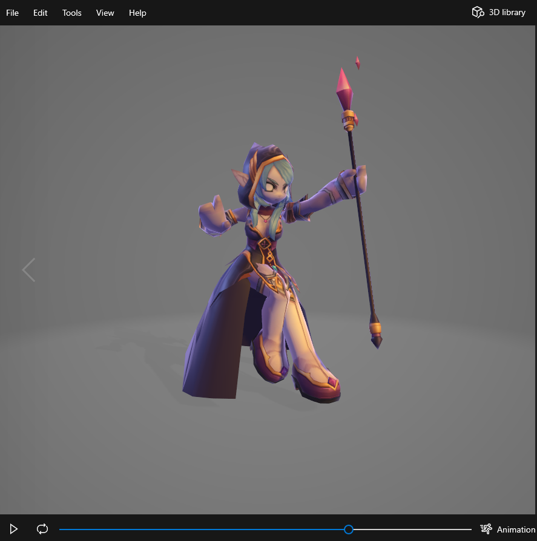
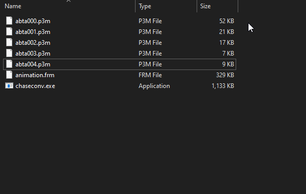

# Chaseconv

[](https://github.com/gabriel-dev/chaseconv/releases/latest)
[](https://github.com/gabriel-dev/chaseconv/releases/latest)
[](./LICENSE)

Chaseconv is a fast and simple 3D asset converter for [Grand Chase](https://en.wikipedia.org/wiki/Grand_Chase). It can convert 3D assets from the game into GLTF files and vice-versa.



## Download

You can download the application in the [Releases Page](https://github.com/gabriel-dev/chaseconv/releases/latest).

## Usage

### Interactive mode

1. Drag and drop the desired files onto `chaseconv.exe` (they should belong to the same model!).
2. Select the format you want to convert the files into.
3. Select the output folder.

Here's a small demonstration:



### CLI mode

```
chaseconv --format <glb|gc> --output <dir> [files...]
```

- `--format` / `-f`: Target format — `glb` (or `gltf`) for GLTF, `gc` (or `p3m`/`frm`) for Grand Chase.
- `--output` / `-o`: Output directory (defaults to `output/`).

Example:

```
chaseconv -f glb -o output/ model.p3m anim_wait.frm anim_run.frm
chaseconv -f gc -o output/ model.glb
```

## Blender workflow

When round-tripping through Blender (GLTF → Blender → GLTF → P3M/FRM), use these export settings to preserve animation data:

- Set the scene FPS to **55** (`bpy.context.scene.render.fps = 55`) before importing the GLB, to match Grand Chase's animation rate.
- Disable force sampling (`export_force_sampling=False`) to preserve original keyframes instead of resampling them.
- Disable optimization (`export_optimize_animation_size=False`) to prevent Blender from removing "redundant" keyframes.
- Export each action separately (`export_animation_mode='ACTIONS'`) and reset pose bones between actions (`export_reset_pose_bones=True`).

## Limitations

### Exporting (GC → GLTF)

- You can't export a standalone animation to GLTF. You can only export animations alongside models because joint data is stored inside P3M files.
- Some animations may lose data when being exported. That's because some models have fewer joints than their animations. So the extra animation channels end up being discarded.

### Importing (GLTF → GC)

- All bones of the model should be named "bone_X", where X is the index of the bone (e.g., "bone_0", "bone_1", ...). The root bone should be named "root".
- Bone rotations in the bind pose are supported. Models exported from tools like Blender (which may add bone orientation rotations) can be converted back without issues.
- Regarding animations, the bones of the model only support rotations, whereas the root bone only supports translations.
- Only the first skeleton/skin in each GLTF file will be taken into account.
- Bone rotation matrices undergo a quaternion round-trip during conversion, which introduces precision loss of ~0.03–0.05°.

## Contributing

- Found a bug? Please create an issue describing the problem.

- Looking for a specific feature? Feel free to leave a pull request.
